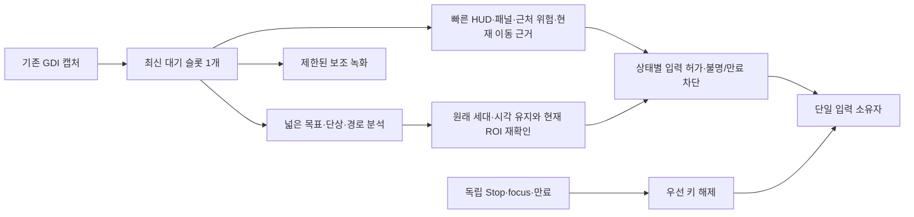

# REFACTOR-0004: CPU 중심 실시간 판단 지연 구조 검토

## Purpose

최신 목표 해석은 [FEAT-0030의 Scope And Acceptance](../feature/feat-0030-cpu-realtime-control.md#scope-and-acceptance)를 따른다.50ms는 필수 합격선이 아니다. 프로그램의 기능·판독 품질·안전성을 유지하고, 매번 필요하지 않은 작업과 중복 준비·복사·합류 대기를 실제 반응 경로에서 줄이는 것이 목적이다. 수치 미달 자체를 실패/종료 근거로 삼지 않으며 달성 가능성은 측정으로 판단한다.

2026-10-24 사용자 요청에 따라 약50ms 반응 목표를 현재 화면 기반 설계로 달성할 경로를 검토하고 구현한다. 안전·overflow 방지·자원 회수가 우선이고 본체는 판단/입력, 녹화는 검증/개선용 보조다. WGC/GPU 도입은 보류한다. 최신 사용자 지시가 CPU 계획과 연속 조준 대기 개선·녹화 병행 감독 게임을 승인했으며, 실행 계약은 [FEAT-0030](../feature/feat-0030-cpu-realtime-control.md)과 [SPEC-0030](../spec/spec-0030-cpu-realtime-control.md), 시도 상태는 [RUN-20261024-02](../run/run-20261024-02-cpu-realtime-control.md)가 소유한다.

## Refactor Type

- 상태: `approved / implementing`; G의 코드/패키지 검증은 통과했지만50ms·peak 효율 목표는 미달이며 전체 parity/게임 수용은 미확정이다.
- Step1–2의 같은 프레임 준비/계산 재사용은 Structural 후보다. Step3–4의 판독 주기·결과 소비·조준 대기는 Behavioral/Semantic 경계이며 같은 결과라고 미리 부르지 않는다.
- [REFACTOR-0003](refactor-0003-rust-efficiency.md)의 계산/codec/잔류 메모리 개선에서 제어 지연·관찰 유효성으로 지배적 위험이 옮겨 새 트랙으로 분리한다. 기존 [FEAT-0029](../feature/feat-0029-rust-runtime-efficiency.md)와 게임 수용 실적을 자동 완료하지 않는다.

## Scope

기준은 [EVAL-0032](../evaluation/eval-0032-rust-runtime-efficiency.md)의 현재 EXE16,670,208B/SHA256 `92ee301f0fde68e4bc1dda880eb681c31bbc636022d033b5fa5232e90779d990`, production source237개 집계 `7d56f7185fb5f2b1b1bc547aa8dd10d15f132cb2750704c33c8a8acd6cff9324`다. Git 기준 `cde68bc2eb1285eddcd8a261cdfe411ed4924f76` 위의 이 작업 상태를 비교 대상으로 고정하며 HEAD만으로 최신 Rust를 표현하지 않는다. 이전 실행 상세는 [RUN-20261024-01](../run/run-20261024-01-rust-runtime-efficiency.md)이 소유한다.

### 기준 시점 설계 판단 — 구현 전

한 프레임의 근거·순서와 중단/키 해제를 검증하기에는 현재 구조가 명시적이다. 그러나 다음 캡처가 넓은 목표/단상 검색·motion·경로 판단까지 기다리므로50ms의 짧은 피드백 주기에 불리하다. worker를 늘리거나 캡처 API만 바꿔 해결됐다고 볼 수 없다.

| 근거 | 현재 구현과 의미 |
| --- | --- |
| 시각의 정정 | [engine](../../../src/runs/summoner/continuous_navigation/engine.rs)의 `acquired=c.now()`가 snapshot/capture보다 앞선다. 기존218–236ms는 캡처를 포함한 반복 요청→판독 완료다.17ms를 다시 더하지 않는다. `processed_at`은 최종 이동 입력 전이고 실제 game acknowledgement가 아니다. |
| 빠른 공격은 이미 있음 | 같은 engine은 HUD/패널/ground/threats 후 가까운 적을 찾으면 `start_plan` 전에 combat을 요청한다. 모든 공격이 전체218ms를 기다린다는 설명은 틀리다. 다만 그 뒤 전체 단계가 끝나야 다음 화면을 읽어 새 적의 발견이 늦을 수 있다. |
| 동시 실행과 합류 | [native](../../../src/runs/summoner/continuous_navigation/native.rs)의 관찰 worker3/queue3이 hazard/hover, path/terminal/objective, motion/terrain을 단계별 겹친다. objective/plan/terminal 합류와 후속 motion이 이동 경로에 남는다. 계산 내부는 공유8-worker다. |
| 큰 반복 비용 | 고정 입력30/3 p50에서 terminal83.410ms, objective58.627ms, cold panels19.062ms, ORB pair15.409ms다. 서로 겹치므로 합계를 실게임 시간으로 쓰지 않는다. 단상은99개 layout-part 선언을35개 고유 path로 공유하고 별도 chest6/detail19도 있다. 매번 모든 선언99개를 독립 재검색한다고 과장하지 않는다. |
| 기존 재사용 | panel은 같은 불변 Arc의 결과를 Weak로 memo한다. GrayMatcher는 gray/누적합, terminal은 관찰 내 중복 part 결과를 공유한다. hazard는 최대2개 crop, hover/target도 crop이다. 이미 있는 ROI/병렬화/캐시를 없는 것으로 가정하지 않는다. |
| 남은 계산 | [template matcher](../../../src/common/vision_ops/template.rs)는 FFT plan을 cache하지만 model spectrum/source tile spectrum/결과 맵은 호출마다 다시 만든다. full map 뒤 argmax만 쓰는 소비자와 다중 peak/suppression 소비자를 구분해야 한다. 소스 검증 루프가 u8에서 최적화로 제거되는지는 확인하지 않았으므로 그 줄을 측정된 병목으로 단정하지 않는다. |
| 입력 자체의 대기 | [operations](../../../src/runs/summoner/main_run/native/runtime/operations.rs)는 aim settle0.05초를 지정한다. [held input](../../../src/common/field_control/held_input.rs)은 새 aim 이후 그 시간 전에 새 keydown을 보내지 않으며, [session](../../../src/common/field_control/session.rs)은20ms 간격으로 service한다. 이 조건의 새 aim→새 keydown까지 포함하면 캡처부터50ms 목표와 충돌한다. 기존 hold/동일 aim/새 aim 없는 combat은 다른 경우다. |
| 재사용할 기반 | [common realtime](../../../src/common/realtime/runtime.rs)에 capture/Fast/Slow/decision 분리는 있으나 현재 production Summoner 호출로 연결되지 않았다. 기본8fps=125ms/최근5프레임은50ms에 맞게 검토해야 한다. decision의 source를 단순 최신 frame으로 붙이는 방식도 실제 소비한 fast/slow 근거와 대조해야 하며 그대로 연결하지 않는다. |

### 50ms의 측정 경계

1. 우선 설계 목표 후보는 **캡처 요청 직전→해당 판단의 실제 입력 제출 완료 p95 약50ms**다. directive 반환이 pending aim일 수 있어 실제 keydown/keyup/mouse 입력 시각을 구분한다. 무입력 hold를 빠른 반응 성공으로 세지 않는다. 사용자가 요구한 약50ms를 아직 hard maximum SLA로 확정하지 않는다.
2. **장면 변화→입력 제출**에는 새 화면을 기다리는 표본화 지연이 추가된다. 처리50ms만 달성해도 변화 직후50ms 반응이 자동 보장되지 않는다. 통제된 입력 없는 화면 변화 재생으로 phase별 측정이 필요하다.
3. **입력 제출→게임 화면의 효과**에는 게임의 시전·갱신·처리 시간이 추가된다. [SendInput](https://learn.microsoft.com/en-us/windows/win32/api/winuser/nf-winuser-sendinput)의 반환은 OS 입력 stream에 넣은 이벤트 수이지 게임 효과 확인이 아니다. 같은 monotonic clock으로 단계 차이를 측정한다([Microsoft timing guidance](https://learn.microsoft.com/en-us/windows/win32/sysinfo/acquiring-high-resolution-time-stamps)).

현재 캡처는 해당 검사에서 p50약17ms/p95약32.2ms였다. “항상20ms 이내”가 아니다. 남는 시간을 단순33ms로 고정하거나 독립 stage p95를 더해 전체 p95라고 하지 않는다. 예산 후보는 capture18ms, 공유 준비/HUD/panels7ms, local 판단17ms, guard/입력 제출3ms, 여유5ms=50ms다. 이는 새 aim 안정화 대기가 필요 없는 즉시 대응의 **설계 배분**이며 미측정 목표다. 전체 trace의 p95/p99/max를 검증해야 한다. 모든 목표/경로 판독을50ms마다 끝내는 목표는 현재83ms terminal 계산까지 재설계해야 해 별도 난도가 있다.

화면 변화부터50ms를 목표로 한다면 이 예산도 더 작아야 한다. 단순한 주기 모델의 지연은 `다음 캡처 대기 + capture→input`이므로, 예를 들어 대기 상한20ms와 처리30ms가 합쳐져50ms가 되는 설계 예시다. 이는 현재 캡처 주기/처리 시간이나 percentile 보장이 아니며 실제 phase와 Windows 스케줄 지연으로 확인해야 한다.

## Non-Goals

WGC/GPU·새 모델/의존성 도입, 게임 내부 접근/hook, guard·250ms freshness·수치 임계값·시전/FCR 계약의 조용한 완화, 녹화 화질/해상도/FPS 축소, 개발 자산/원본 설정 삭제, 현재 전체 게임 수용을 PASS로 변경하는 작업은 포함하지 않는다. 초기 읽기 검토 뒤 사용자가 CPU 구현·조준 대기 개선·감독 게임을 승인했다. 현재는 그 경계 안에서 실행하며 코드 복귀는 기존 north→중앙→Act1→저장 종료를 사용한다.

## Invariants

- 입력 단일 소유, 독립 Stop/focus/만료 해제와 실제 worker/OS 자원 회수를 유지한다. vision/디스크/GUI의 잠금 뒤에 안전 해제를 줄 세우지 않는다.
- 새 결과에는 실제 frame sequence/관찰 시각·방/입력/이동·geometry 세대를 붙인다. 오래된 slow negative를 현재 clear로 쓰거나 새 프레임 시각으로 재명명하지 않는다. positive/negative/unknown과 stale/실패를 구분한다.
- 같은 프레임 준비 cache는 frame identity+ROI 원점/크기+encoding+scale+FFT tile 원점/stride/padding/정밀도로 식별한다. 같은 FFT 크기만으로 서로 다른 tile을 섞지 않는다. 불변 model 준비값은 model 소유, scratch는 작업 소유, 마지막 소비 뒤 회수한다.
- 최신 대기 슬롯1개가 전체 RAM 프레임1개를 뜻하지 않는다. producer·fast·slow·녹화의 실행 중 소유와 codec의 원본/복원 버퍼까지 총 byte/개수 상한에 포함한다. 일반 runtime의5장 BGR만도1922×1140에서32,866,200B이며 snapshot에 필요한 근거와 보존 목적을 정해야 한다.
- 정확한 재사용/연산 순서 유지 후보와 cadence/ROI/조준 계약 변경을 분리한다. 수치·동점·최고 점수·다중 peak·false positive/negative/unknown·오류 순서가 바뀌면 parity 미확정으로 돌려 원인을 기록한다.

## Planned Work

### Step 1 — 실제 비용과 입력 시각 계측

Goal: 한 반복과 동작별 실제 반응을 분리하고50ms를 소비하는 경로를 고정한다.
Why this grouping: 현재 processed/acquired 명칭과 directive 반환만으로 실제 입력 반응을 알 수 없다.
Guardrails: 수치/시한/입력 동작은 유지한다. 입력 없는 재생을 먼저 쓰고 기존 독립 중단 소유자를 유지한다.
Targets: continuous engine/native, capture의 전후, pool enqueue/start/finish, frame 전처리, 실제 input backend 전후, aim pending/service.
Validation: 같은 시계로 capture 시작/완료·각 단계·큐 대기·결과 age·directive·실제 전송을 기록한다. travel/combat/release/new aim/동일 aim을 분리하고 녹화OFF/ON/느린 writer의 p50/p95/p99/max·누락/hold를 비교한다.
Exit gate: 실제 deadline 실패와 자연스러운 시전/조준 대기를 구분한 trace가 있고 후속 수정별 baseline이 확정된다.

### Step 2 — 동일 결과의 CPU 준비·배치 연산

Goal: 같은 frame/model에 대한 중복 변환·FFT·full map 쓰기를 줄인다.
Why this grouping: 관찰 주기를 낮추기 전에 같은 판독 결과를 더 싸게 만드는 범위다.
Guardrails: frame/ROI/encoding/FFT tile geometry가 같은 준비값만 재사용한다. crop 전 resize와 resize 후 crop의 좌표·halo·반올림을 검증한다. template를 첫 threshold 통과에서 중단해 argmax를 바꾸지 않는다.
Targets: 공유 FrameAnalysis/GrayMatcher, immutable prepared template spectra, compatible tile batched matching, panel의 전용 current ROI 경로, peak-only API를 쓸 수 있는 journal/단일 peak 소비자.
Validation: 기존 source와 경계/threshold/tie/constant/odd-size/오류를 비교한다. 다중 peak terminal의 suppression 의미를 별도 검사한다. 시간뿐 아니라 peak/반복 후 memory를 측정하고 cache hit ratio·실제 절약 연산을 확인한다.
Exit gate: 동일 판정·오류와 bounded 메모리를 입증한 변경만 채택한다. 저장 이미지 검사만으로 실게임50ms를 선언하지 않는다.

### Step 3 — CPU latest-frame와 빠른 제어의 독립 실행

Goal: 넓은 목표/단상 분석이 끝나기 전에 다음 유효 화면의 HUD/근처 위험·현재 이동 근거를 판단한다.
Why this grouping: 한 반복을200ms에서50ms로 줄이는 것과 새 위험을50ms 주기로 볼 수 있게 하는 것은 별도 문제다.
Guardrails: 새 캡처는 최신 대기 slot을 덮되 소비 중 buffer를 수정하지 않는다. slow 결과는 원래 source를 유지하고, 적용 직전 현재 작은 ROI 재확인/기하 대응이 필요하다. 미관측을 clear로 삼지 않는다. 어떤 상태에서 fast 근거만으로 이동 가능한지 먼저 명시한다.
Targets: 기존 RealtimeVisionRuntime의 재사용 가능 계약과 Summoner state adapter, fast/slow 우선 compute 자원 배분, 단일 input arbiter, 독립 낮은 우선도의 bounded recorder.

제안 흐름(현재 구현 아님):

Validation: 늦거나 순서가 뒤집힌 결과·이동/geometry/입력 세대 변경·소비 정지/큐 포화·취소·없는 새 frame을 가짜 시계로 재생한다. 안전 해제는 무거운 job과 writer를 기다리지 않아야 한다. 캡처/판독 예산과 녹화8fps를 분리한다.
Exit gate: 새 cadence/positive-negative-unknown/slow 결과 유효성 계약을 owner가 검토한 뒤 실행한다. 연결만으로 구현 완료/50ms를 주장하지 않는다.

### Step 4 — 상태별 추적·재획득과 새 aim 계약

Goal: 알고 있는 근처 위치는 검증된 작은 검색으로 추적하고 불확실할 때 넓은 재획득으로 돌아간다. 새 aim keydown의50ms 충돌을 명시적으로 해결한다.
Why this grouping: 검색 범위/주기와 조준 대기는 관찰·입력 의미를 바꾸므로 계산 cache와 다른 위험이다.
Guardrails: 카메라 이동/새 방/가림/일치 실패/기한 경과 시 local track을 무효화한다. full search fallback이 실패하면 안전 hold한다.50ms aim settle을 임의로0으로 바꾸지 않고 실제 pointer/game 확인 근거와 기존 시전 계약을 검토한다.
Targets: terminal/objective의 local verify/global reacquire, canyon journal/portal/arrival 단계의 비용·deadline trace, held input의 aim/actual keydown 상태.
Validation: 같은 단상 positive/false positive·빠른 화면 이동·빈 길·비슷한 타일·단상 재획득·협곡 마감 실패 재생을 검사한다. 새 aim/기존 hold/키 전환을 따로 측정하고 필요한 경우 감독 실게임으로 검증한다.
Exit gate: 미검출/늦은 검출의 허용과 입력 대기 의미를 정한 후 별도 approved feature/spec으로 실행한다. 현재 협곡/재획득 문제를 파일 누락이나 latency 하나로 단정하지 않는다.

### Step 5 — 통합 반응/녹화/메모리 검증

Goal: 승인한 CPU 구조의 실제 반응과 recorder의 보조 역할을 검증한다.
Why this grouping: 빠른 개별 함수와 전체 최신 관찰·실제 입력은 같지 않다.
Guardrails: 정상 이동/전투가 없는 hold-only 수치를50ms 성공으로 세지 않는다. full gameplay/키 획득·기존10연속/27-of-30 실적은 별도다.
Targets: 최종 같은 PC/장면 재생, 승인한 제한 실게임, 녹화OFF/ON/느린 writer, 최종 배포 loader/자산 closure.
Validation: end-to-end 동작별 p50/p95/p99/max, 표시된 변화부터의 반응, frame age/stale/판독 누락, 입력 해제, actual joins, CPU/peak·반복 후 memory, 녹화 누락/독립 decode를 비교한다.
Exit gate: 실제 반응 범위와 기능/안전 실패를 구분해 보고한다.50ms 초과 여부만으로 합격/실패를 정하지 않고 제거 가능한 지배 비용이 남았는지 trace로 판단한다. 기능/판독 품질·안전성을 유지하는 개선을 채택하고 효과 없는 복잡성은 제거한다. WGC/GPU는 계속 보류하며 변경 필요성은 측정 근거와 기존 승인 경계에서 다룬다.

## Validation Gates

실행 중에는 각 Step의 source/fake/stored/native 범위를 구분하고 configured fmt/check/Clippy와 영향받는 검사를 수행한다. 같은 연산 준비 공유도 출력·실패·취소·해제 gate를 통과해야 한다. actor 분리/주기/조준 의미 변경의 구체 계약은 SPEC-0030에서 구현보다 먼저 고정한다. 단계별 percentile의 합이나 recorder 성능으로50ms를 대체하지 않는다.

## 구현 상태 — 2026-10-24

현재 적용한 구조는 panel Area ROI/정수 SIMD, 요청 방식 producer1/대기1 캡처, 실제 source/입력 반환 계측, 현재 panel/HUD overlap, broad 탐색의 bounded pending·현재 양성 확인, foreground/background 계산6+2, local phase의 중앙 재검색 생략/100ms mapping 하한이다. 연속 aim의 고정50ms 대기는 실제 pointer 확인으로 대체했고 pointer 확인 뒤 clock을 재조회해0ms도 다음 service로 밀리던 오류를 고쳤다. GDI DIB는 한 호출에서 소유·초기화·flush·복사·해제한다. 상세 계약은 SPEC, 전후 측정/실패는 [EVAL-0033](../evaluation/eval-0033-cpu-realtime-control.md)이 소유한다.

채택 G의 실게임은 near p50/p9558.280/72.101ms, 새F2 source→return138.095/172.567ms로50ms 미달이다. F의 current full 확인도 broad host/계산2에 배치돼 생긴 p95 objective 합류267.255ms/185 stale hold에 대해 G는 현재 확인만 foreground로 옮겼다. G는 인식/확인 횟수/유효성 검사를 유지하며 objective p9536.374ms/stale5행을 기록했지만 다른 방이므로 정확한 인과 절감률은 아니다. H 발밑/착지 합류 분리는 같은 고정 입력33.1326ms 대 G33.0639ms로 이득이 없어 제거했다. 독립50ms 안전 판단 loop, local tracking crop, 전체 협곡·재획득 성공과 표시된 변화→입력50ms는 완료하지 않았다. 위 Step3–5의 미구현 제안을 현재 기능으로 읽지 않는다.

## Intentional Deltas

승인된 의미 변경은 요청 시점의 새 frame 선택, 미획득 broad 결과의 unknown/현재 재확인, local phase, 연속 입력의 추가 settling 제거다. 원래 source와250ms freshness·focus/geometry·Stop·실제 pointer 확인·키 해제·overflow 경계를 유지한다. 기존 타이밍/threshold/행동 적응은 구조 검증 뒤 조정할 수 있지만 안전 검사를 생략하는 근거가 되지 않는다. 핫키 의미와 원본 config/assets는 유지한다. portable package는 실행 위치와 독립적으로 sibling runtime 자산을 찾으며 필수 assets/regions를 포함한다.

## Risks / Open Questions

50ms의 fast 경로 p95와 모든 동작/표시 변화→화면 효과의 hard maximum은 구분한다. 연속 aim의 추가 대기는 제거했지만 실제 capture/판독/새 이동 입력 수치는 아직50ms를 넘는다. Windows scheduling과 게임 처리까지 strict bound로 주장하지 않는다. 안전/근접 판단·새 aim·반복·화면 효과를 나눠 보고하며 독립 fast loop와 local tracking의 recall/안전 계약은 추가 검증이 필요하다.

## Exit Goal

어느 작업을 매번 해야 하고 어느 작업은 같은 frame에서 공유하거나 현재 상태의 검증으로 제한할 수 있는지 추적 가능한 CPU 설계를 만든다. 구현 전 평가 경계·기존50ms 대기 충돌·source/세대/unknown과 자원 상한을 정하고, 실제 전후 trace로50ms 달성 여부를 판정한다. 배포 축소의 별도 근거/한계는 [EVAL-0032의 자산 감사](../evaluation/eval-0032-rust-runtime-efficiency.md#package-asset-audit-and-coverage)를 따른다.
